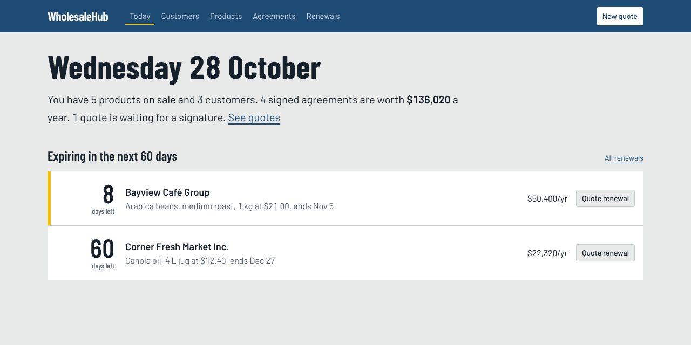

# WholesaleHub

Back-office app for a wholesale distributor. Account managers use it to keep track of
**customers** (shops, cafés, contractors…), the **product catalog**, and the **price agreements**
we negotiate with each customer: a fixed price on a product for a few months, in exchange for
a committed yearly volume.

The main screen is the "dock board": signed agreements that are about to run out, so someone
calls the customer before their price goes back to list.

Angular 22 + Spartan UI · ASP.NET Core 10 · EF Core · SQL Server



## Running it

Easiest is Docker:

```bash
docker compose up --build
```

then open http://localhost:8080. It creates the database and adds some sample data.

Without Docker for the app itself (you still need a SQL Server somewhere):

```bash
docker compose up -d db                     # or use your own SQL Server / LocalDB
dotnet run --project src/WholesaleHub.Api   # http://localhost:5080, swagger at /swagger
cd client && npm install && npm start       # http://localhost:4200
```

The API migrates + seeds the DB on startup in Development. Connection string is in
`src/WholesaleHub.Api/appsettings.json`. For LocalDB on Windows:

```bash
dotnet user-secrets --project src/WholesaleHub.Api set "ConnectionStrings:WholesaleHub" "Server=(localdb)\MSSQLLocalDB;Database=WholesaleHub;Trusted_Connection=True"
```

Node 22.22+ or 24 is needed (Angular 22 requirement).

## Tests

```bash
dotnet test                      # unit tests + integration tests (integration ones need Docker running)
cd client && npm run test:ci     # angular tests (vitest)
```

The integration tests start a real SQL Server in a container with Testcontainers and call the
API over HTTP through `WebApplicationFactory`. I went with that instead of the EF in-memory
provider because in-memory doesn't check unique indexes, check constraints or decimal precision,
which are exactly the things that broke while I was building this.

## How it's put together

```
src/
  WholesaleHub.Domain          entities + business rules, no dependencies
  WholesaleHub.Application     services (one method per use case), DTOs, validators, repo interfaces
  WholesaleHub.Infrastructure  EF Core / SQL Server, repositories, read queries, migrations, seed data
  WholesaleHub.Api             MVC controllers, error handling, Program.cs
tests/
  WholesaleHub.UnitTests         domain + services (xUnit, NSubstitute, FakeTimeProvider)
  WholesaleHub.IntegrationTests  real HTTP + real SQL Server
client/                          Angular app
  libs/ui/                       Spartan UI components (generated by the spartan cli, then themed)
  src/app/core                   api services, models, error interceptor
  src/app/shared                 dock board, pricing math, form helpers, pipes
  src/app/pages                  one folder per screen
```

Some decisions worth explaining:

- **Business rules live in the entities.** `PriceAgreement` can only be changed through
  `CreateDraft` / `Activate` / `Cancel`, and each one checks its own rules (term 3–36 months,
  price can't be above list or more than 40% under it, can't sign twice, etc.). The services just
  load things, call those methods and save.
- **Validation happens in layers.** FluentValidation checks the request shape and returns every
  field error at once (the form shows them next to the inputs). The domain checks the real rules.
  The DB has unique indexes and check constraints as a last line of defence.
- **Reads and writes are split (light CQRS).** Writes load entities through repositories. Lists and the
  dashboard use `IAgreementQueries`, which projects straight to DTOs with joins in SQL.
- **Agreements copy the list price and unit when they're quoted**, so changing a product's list price
  later doesn't rewrite old discounts. Unit of measure can't be edited at all for the same reason.
- **"Expired" isn't stored**, it's worked out from the end date, so nothing has to run at midnight to update it.
- **Errors are ProblemDetails everywhere.** 400 for bad input, 404, 409 for duplicates/overlaps/concurrent edits,
  422 for business rules. See `GlobalExceptionHandler`.
- **rowversion columns** on every table, mapped as EF shadow properties, so two simultaneous saves on the
  same row give a 409 instead of one silently winning.
- **Time comes from `TimeProvider`**, which is why the tests can freeze the clock.

### Where's the MVC?

The API is ASP.NET Core MVC: controllers (`[ApiController]`, attribute routing, model binding,
`CreatedAtAction` for 201s), models are the request/response DTOs, and the "view" is the JSON the
Angular app renders. No Razor views since the UI is a SPA.

### UI

Built with [Spartan UI](https://spartan.ng) (shadcn-style components for Angular, on Tailwind 4).
Spartan copies the component source into `client/libs/ui`, so they're themed and owned here, not
hidden in node_modules.

The look is meant to feel like a warehouse floor instead of a generic SaaS dashboard: concrete-grey
background, dock-blue for the main colour, Barlow / Barlow Condensed (fonts based on road and
industrial signage), and safety yellow used **only** for things that need action soon (renewals
inside 14 days, expired badges). The dashboard summary is a plain sentence instead of stat tiles.

## API

| | | |
|---|---|---|
| GET | `/api/customers?search=&page=` | search customers |
| GET/PUT | `/api/customers/{id}` | |
| POST | `/api/customers` | |
| GET | `/api/products?search=&includeDiscontinued=` | |
| GET/PUT | `/api/products/{id}` | |
| POST | `/api/products` | |
| POST | `/api/products/{id}/discontinue` · `/reinstate` | |
| GET | `/api/agreements?status=&customerId=&productId=` | |
| GET | `/api/agreements/{id}` | |
| POST | `/api/agreements` | create a quote (draft) |
| POST | `/api/agreements/{id}/sign` | 409 if it overlaps another signed agreement |
| POST | `/api/agreements/{id}/cancel` | body: `{ "reason": "..." }` |
| GET | `/api/agreements/renewals?withinDays=60` | |
| GET | `/api/dashboard` | |
| GET | `/health` | includes a DB check |

## Known gaps / TODO

There are `TODO` / `FIXME` comments in the code where these come up. The main ones:

- No login or roles yet. Probably Entra ID / JWT, with only managers allowed to approve big discounts
  (right now anything over 40% off is just blocked).
- Signing two overlapping quotes at the exact same moment could get both through. Needs a serializable
  transaction or an app lock around the overlap check.
- "Today" is UTC, so a quote made late evening in Toronto counts as tomorrow.
- Customer and product pickers on the quote form only load the first 100. Needs a searchable combobox.
- No delete for customers (would need a soft delete because of agreement history).
- Dark mode (the tokens are there, not designed yet).
- TS models are written by hand; should be generated from the OpenAPI doc.
